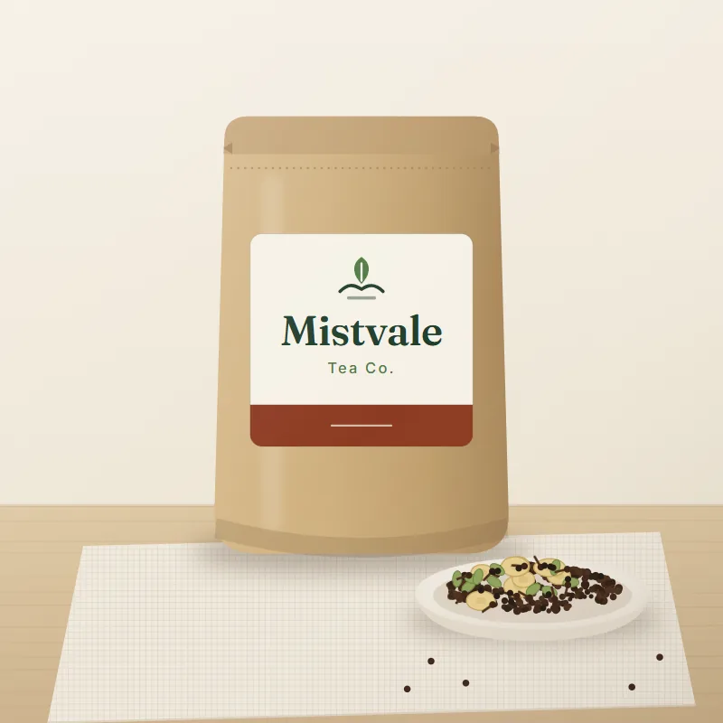

# Mistvale Tea Co. — online tea store (Python + Streamlit)

An online store for **Mistvale Tea Co.**, a fictional tea brand from the Darjeeling hills, written entirely in Python with Streamlit. The business logic is a plain, framework-free Python package with its own test suite; the Streamlit app is only the UI on top.

**Live demo:** https://pratik-mistvale-tea.streamlit.app/



## Features

- **Shop:** search, category filter and sort work together, and their state is kept in the URL (`?cat=green&sort=Lowest+price&q=chai`) so links can be shared. Sold-out teas always sort last.
- **Product details** in a dialog, with a quantity picker and "You may also like" suggestions. Recently viewed teas and a saved wishlist are kept for the session.
- **Cart** in the sidebar:
  - quantity per line, remove, and a free-shipping progress bar
  - coupon entry with clear messages, and a "New here? Try WELCOME10" hint
  - a subtotal / discount / shipping / total breakdown
- **Checkout** builds the order payload for the store's checkout API (`{"items": [{"id", "qty"}], "coupon"}`). The demo endpoint is a placeholder, so no order is placed.
- **Delivery check** by pincode: shows the estimate in days, "not serviceable", or a clear error for an invalid pincode.
- **Content:** reviews, an FAQ accordion, a newsletter sign-up with validation, and a footer with contact details.
- **Brand theme** via `.streamlit/config.toml`: tea green, cream and parchment colours, Inter + Fraunces fonts, and a 12px radius.

## Business rules (`mistvale/cart.py`)

| Rule | Behaviour |
|---|---|
| Prices | Always taken from the product data, per pack, GST included |
| Limits | At most 5 of a tea, never more than its stock; sold-out teas can't be added |
| WELCOME10 | 10% off eligible items (gift boxes excluded), capped at ₹150, needs a ₹399 subtotal, case-insensitive, can't be applied twice |
| Shipping | ₹49, free when the amount **after** the discount reaches ₹599 |
| Rounding | All maths in `Decimal`; only the final total is rounded; ₹ with Indian grouping (₹1,23,456) |

## Project structure

```
app.py                 Streamlit UI
mistvale/data.py       products, company facts, FAQ, reviews
mistvale/api.py        simulated backend: search, pincode delivery check
mistvale/cart.py       cart rules, totals, coupon, checkout payload, ₹ formatting
tests/test_cart.py     unit tests for every rule
tests/test_app.py      UI tests that drive the real app with Streamlit's AppTest
tools/optimize_images.py   crops and compresses product images to 800×800 WebP
.streamlit/config.toml brand theme
```

## Run it locally

```bash
pip install -r requirements.txt
streamlit run app.py
```

## Tests

```bash
pip install -r requirements.txt -r requirements-dev.txt
pytest
```

There are 27 tests. They cover the coupon (minimum spend, gift exclusion, ₹150 cap), shipping after the discount, the limit of 5 and the stock limit, sold-out sorting, filter + search + sort together, pincodes, cleaning a corrupted cart, and the checkout payload. They also drive the real app through add → change quantity → apply coupon.

## Deploy

On [Streamlit Community Cloud](https://share.streamlit.io): **New app**, then choose this repo, branch `main`, main file `app.py`.

## Built with

Python 3.10+, Streamlit, pytest and Pillow (image tool only). Developed with Claude Code as an AI pair programmer. I directed and reviewed each change and checked it with automated tests and in-browser runs.
